<picture>
  <source media="(prefers-color-scheme: dark)" srcset="https://raw.githubusercontent.com/Pavindud/Pavindud/output/snake-dark.svg">
  
</picture>

## Things I've built
- **Chess Analyzer**: Flask app with Stockfish integration
- **Clan Leaderboard**: React leaderboard for a Clash of Clans clan
- **Part-time Jobs Site**: React, PHP and MySQL job board
- **Face Recognition Attendance**: Raspberry Pi attendance system

## Reach me
[LinkedIn](https://linkedin.com/in/your-link) · [Email](mailto:you@example.com)